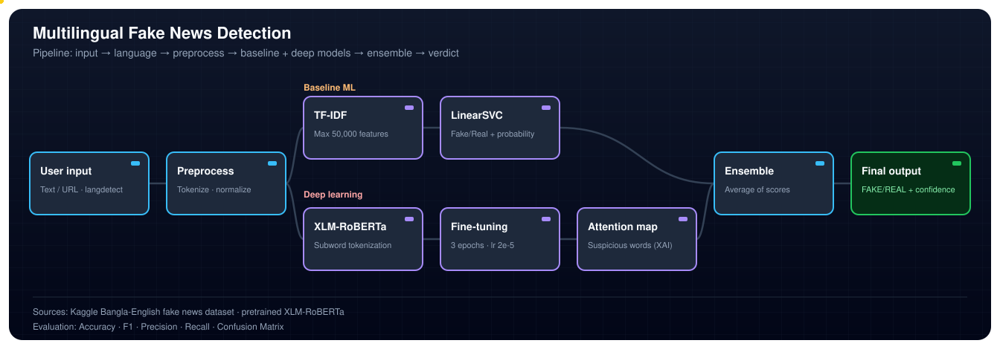

# Multilingual Fake News Detection (Bangla & English)

A hybrid machine learning and deep learning system that classifies news articles as **Fake** or **Real** in both Bangla and English. It combines a classical baseline (TF-IDF + LinearSVC) with a fine-tuned multilingual transformer (XLM-RoBERTa), averages their probabilities in an ensemble, and uses attention visualization to show which words influenced the deep model's decision.

**Authors:** Alif Mahmud Talha
**Affiliation:** Department of Computer Science and Engineering, University of Asia Pacific (UAP), Dhaka



---

## Table of Contents

- [Motivation](#motivation)
- [Objectives](#objectives)
- [Scope](#scope)
- [Dataset](#dataset)
- [Preprocessing](#preprocessing)
- [System Design](#system-design)
- [Models](#models)
- [Ensemble](#ensemble)
- [Explainable AI](#explainable-ai)
- [Results](#results)
- [Limitations](#limitations)
- [Tech Stack](#tech-stack)
- [Repository Contents](#repository-contents)
- [Getting Started](#getting-started)
- [Future Work](#future-work)
- [References](#references)

---

## Motivation

Fake news spreads quickly on social media, and in Bangla-speaking regions it can cause real harm. One example is the 2019 Padma Bridge rumour in Bangladesh, which caused confusion and, in some cases, mob violence linked to social media posts.

Research on fake news detection is mostly done in English. Bangla is a low-resource language, and few automated tools are available to the public. Existing Bangla approaches often use traditional machine learning on TF-IDF or Word2Vec features, which do not capture the context and meaning of a sentence well. That is why performance on Bangla is usually much lower than on English.

## Objectives

- Build a fake news detection system that supports both **Bangla** and **English**.
- Implement a **hybrid ensemble** that combines TF-IDF + SVM with XLM-RoBERTa.
- Add **Explainable AI (XAI)** through attention visualization of suspicious words.
- Detect the input language automatically.
- Reach 95%+ accuracy on Bangla and 97%+ on English, the target set in the report.

## Scope

The task is binary classification:

| Language | Fake (label 0) | Real (label 1) |
|---|---|---|
| Bangla | Fake | Real |
| English | False | True |

The system outputs the detected language, the predicted class, a confidence score, and the words that contributed most to the decision.

---

## Dataset

- **Name:** Fake News Detection for Bangla-English
- **Source:** Kaggle
- **Link:** <!-- TODO: paste the exact Kaggle dataset URL here, e.g. https://www.kaggle.com/datasets/<username>/<dataset-name> -->
- **Main file used:** `Fake_Real.csv`
- **Size:** 15,998 articles (9,092 Bangla, 6,906 English)

### Columns

| Column | Description |
|---|---|
| `text` | Full news article content |
| `subject` | News category (e.g., National, politicsNews, Sports, International) |
| `level` | Binary label: **0.0 = Fake**, **1.0 = Real** |

After preprocessing, the `level` column is converted to integers (**0 = Fake**, **1 = Real**).

### Class Distribution

| Category | Count |
|---|---|
| Total articles | 15,998 |
| Fake (label 0) | 9,681 |
| Real (label 1) | 6,317 |
| Bangla (bn) | 9,092 |
| English (en) | 6,906 |
| After preprocessing | 15,852 |

The dataset is imbalanced, with more Fake samples than Real ones. This is discussed in [Limitations](#limitations).

---

## Preprocessing

1. **Null value removal:** Rows with missing text or label were dropped (123 rows), leaving 15,874 rows.
2. **Text cleaning:** Regular expressions remove URLs and extra whitespace, and normalize text encoding.
3. **Label encoding:** The floating-point `level` column (0.0 / 1.0) is converted to integers (0 / 1).
4. **Language detection:** The `langdetect` library identifies the language of each article. Articles in languages other than Bangla or English are removed, leaving 15,852 rows.
5. **Train-test split:** A stratified 80/20 split with random seed 42 gives 12,681 training samples and 3,171 test samples.

Three columns are added during preprocessing: `label` (integer), `language` (bn / en), and `clean_text`.

---

## System Design

The pipeline runs from user input to an explainable output:

1. **User input:** A news text is provided.
2. **Language detection:** The language is identified as Bangla or English.
3. **Text preprocessing:** The text is cleaned and normalized.
4. **Parallel prediction:**
   - Baseline: TF-IDF + LinearSVC (language-specific)
   - Deep learning: XLM-RoBERTa (fine-tuned)
5. **Ensemble:** Probabilities from both models are averaged.
6. **Final output:** Language, FAKE/REAL label, confidence, and the top suspicious words.

The full pipeline diagram is at the top of this README.

---

## Models

### Model 1: TF-IDF + LinearSVC (Baseline)

- **Vectorizer:** TF-IDF with a maximum of 50,000 features. TF-IDF weights each word by how often it appears in an article, adjusted by how common it is across all articles.
- **Classifier:** LinearSVC (Support Vector Machine with a linear kernel), wrapped in `CalibratedClassifierCV` so it outputs probabilities.
- **Language-specific:** A separate TF-IDF vectorizer and SVM are trained for Bangla and for English. Each model learns words that are specific to its language.

This baseline follows the approach of Hossen et al. (2024), the base paper for this project.

### Model 2: XLM-RoBERTa (Deep Learning)

- **Model:** `xlm-roberta-base` from Hugging Face Transformers. XLM-RoBERTa is a multilingual transformer pretrained on about 2.5 TB of text from 100 languages, including Bangla.
- **Fine-tuning for binary classification (Fake / Real)**

| Hyperparameter | Value |
|---|---|
| Epochs | 3 |
| Batch size | 16 |
| Learning rate | 2e-5 (AdamW optimizer) |
| Max sequence length | 256 tokens |
| Hardware | NVIDIA T4 GPU (Google Colab) |

Unlike TF-IDF, which treats each word on its own, XLM-RoBERTa captures the context of words within a sentence. This helps it handle more subtle patterns in both languages.

---

## Ensemble

The ensemble averages the probability outputs of the two models for each test sample:

```
P_final(class) = [ P_SVM(class) + P_XLM(class) ] / 2
```

The predicted class is the one with the higher averaged probability.

---

## Explainable AI

After classification, attention weights are extracted from the last layer of XLM-RoBERTa:

1. Attention weights are averaged across the attention heads, giving one score per token.
2. Subword tokens are merged back into full words.
3. The top 5 most-attended words are shown as the words that contributed most to the Fake classification.

**Example (English article classified as FAKE with 99.9% confidence):** the top suspicious words were `emissions`, `contradicting`, `scientific`, and `change`.

This makes the system more transparent, because users can see not only the label but also the words that influenced it.

---

## Results

### Model Comparison

| Model | Bangla Acc. | English Acc. | Overall Acc. |
|---|---|---|---|
| Base paper: TF-IDF + SVM (Hossen et al.) | 74.3% | 99.5% | — |
| Ours: TF-IDF + SVM (Baseline) | 73.0% | 99.9% | ~82% |
| Ours: XLM-RoBERTa (Fine-tuned) | 70.0% | 99.7% | 82.5% |
| **Ours: Ensemble (Final)** | **74.4%** | **99.7%** | **85.0%** |
| Target | 95%+ | 97%+ | — |

The ensemble performs best overall. The Bangla accuracy is still below the 95% target.

### Ensemble Evaluation Metrics

Test set: 3,175 samples.

| Class | Precision | Recall | F1-Score | Support |
|---|---|---|---|---|
| Fake (0) | 0.99 | 0.76 | 0.86 | 1,922 |
| Real (1) | 0.73 | 0.98 | 0.84 | 1,253 |
| Macro average | 0.86 | 0.87 | 0.85 | 3,175 |
| **Overall accuracy** | **85.0%** | — | — | 3,175 |

### Confusion Matrix (Ensemble)

| | Predicted Fake | Predicted Real |
|---|---|---|
| **Actual Fake** | 1,465 (TP) | 457 (FN) |
| **Actual Real** | 19 (FP) | 1,234 (TN) |

The ensemble is very reliable when it predicts Fake: only 19 Real articles were flagged as Fake. Most of its errors are Fake articles classified as Real (457). The report attributes this partly to the class imbalance in the Bangla data.

### XLM-RoBERTa Training Loss

| Epoch | Average Loss |
|---|---|
| 1 | 0.3598 |
| 2 | 0.3313 |
| 3 | 0.3133 |

The loss decreases in every epoch, which shows the model is still learning during fine-tuning.

---

## Limitations

- **Bangla performance is low.** Bangla accuracy for the ensemble is 74.4%, which is below the 95% target.
- **Class imbalance.** Fake samples (9,568) outnumber Real samples (6,306) after null removal. This biases the model toward predicting Fake.
- **Explainability is weaker for Bangla.** Attention visualization works less well for Bangla because of how Unicode text is tokenized.
- **Binary classification only.** Satire, clickbait, and opinion pieces are not separated into their own categories.
- **Limited compute.** Training ran on free Google Colab GPUs, which restricts training time and model size.
- **No live fact-checking.** The model predicts from writing patterns learned from the training data. It does not verify claims against real-world evidence.
- **No source verification.** The model does not check whether a news outlet or website is reliable.
- **Dataset dependence.** Performance depends on the labels and topics in the training data. Results may not transfer to news from other periods or sources.
- **Confidence is not certainty.** A high confidence score means the model is confident, not that the article is true.

Use the output as a signal for further human checking, not as a final verdict.

---

## Tech Stack

| Tool / Library | Version | Purpose |
|---|---|---|
| Python | 3.12 | Core programming language |
| Google Colab | T4 GPU (CUDA) | Training environment |
| PyTorch | 2.x | Deep learning framework |
| Hugging Face Transformers | 4.x | XLM-RoBERTa model |
| Scikit-learn | latest | TF-IDF, LinearSVC, calibration |
| Pandas | latest | Data processing |
| langdetect | 1.0.9 | Language detection |
| Matplotlib / Seaborn | latest | Visualization |

---

## Repository Contents

| File | Description |
|---|---|
| `README.md` | Project documentation (this file) |
| `FinalNotebook.ipynb` | Full implementation: preprocessing, training, evaluation, and attention visualization |
| `Complete_IEEE_formatted_report.pdf` | Full IEEE-format research report |
| `fake_news_full_pipeline.svg` | Pipeline diagram |

The trained XLM-RoBERTa model is not included in this repository. It was saved to Google Drive during training.

---

## Getting Started

### 1. Get the dataset

Download `Fake_Real.csv` from the Kaggle link in the [Dataset](#dataset) section and place it in the same folder as the notebook.

### 2. Install dependencies

```bash
pip install pandas scikit-learn langdetect==1.0.9 torch transformers matplotlib seaborn
```

### 3. Run the notebook

Open `FinalNotebook.ipynb` in Google Colab (recommended, with a T4 GPU) or in Jupyter, and run the cells in order:

1. Load and clean the dataset
2. Detect language and filter Bangla and English rows
3. Train the TF-IDF + LinearSVC models
4. Fine-tune XLM-RoBERTa (3 epochs)
5. Compute the ensemble predictions and evaluation metrics
6. Generate the attention visualizations

---

## Future Work

- Expand the Bangla knowledge base with more Bangla news sources, to improve Bangla performance.
- Build a web or mobile application for public use.
- Add support for other South Asian languages, using BanglaBERT for deployment.
- Add trusted source recommendation, which was an objective of the original proposal.
